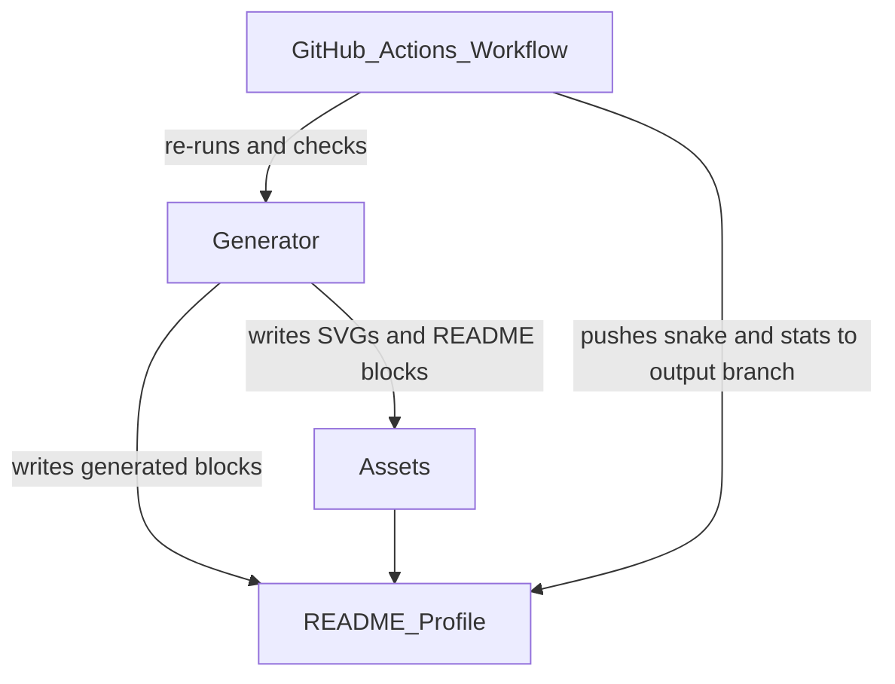

## Stack

GitHub profile README repo (renders on github.com/ALPHAMAN-0). Markdown plus SVGs drawn by dependency-free Node 22 scripts in `.github/scripts/`, and one GitHub Actions workflow.

## Directory map

| path | what lives there |
|---|---|
| README.md | Profile page; blocks between `BEGIN generated` / `END generated` markers are written by render-static.mjs |
| now.json | Availability line and the learning cards |
| assets/ | Generated SVGs (dark, `-light`, `-narrow` for phones) plus the hand-made ascii-portrait.svg |
| .github/scripts/render-static.mjs | Draws every static SVG and writes the README blocks |
| .github/scripts/render-stats.mjs | Draws the stats card from the GitHub GraphQL API into dist/ (CI only) |
| .github/scripts/lib/ | design.mjs (tokens, text, motion), icons.mjs (inline logos), diagram.mjs (card diagrams) |
| .github/scripts/icons/ | Real product logos from pinned sources, with licences |
| .github/workflows/profile-assets.yml | `verify` drift check; `generate` snake + stats to the `output` branch |

## Diagram

## Component index

- [[Generator]]
- [[Assets]]
- [[README_Profile]]
- [[GitHub_Actions_Workflow]]

## Entry points

- Dev: `node .github/scripts/render-static.mjs` (from the repo root)
- Prod: README.md, rendered by GitHub as the profile page; stats and snake from the `output` branch

## Conventions

- Every picture is a `<picture>` with a `(max-width: 600px)` narrow source, a dark source and a light ``.
- Two-up cards are inline images at `width="50%"` with no whitespace between them; the generator writes those rows.
- Animations are finite and their resting state is the finished frame (reduced motion shows it at once).

## Where things go

- To change words, projects, links or the stack: edit the data blocks in `.github/scripts/render-static.mjs`, run it, commit `assets/` and README.md.
- To change availability or the learning cards: edit now.json, run the generator, commit.
- To add a logo: fetch it into `.github/scripts/icons/` (see its README.md) and reference it by file name.
- To change the stats card: edit `.github/scripts/render-stats.mjs`; CI publishes it to the `output` branch.
