<!-- The blocks between BEGIN generated and END generated are written by
     .github/scripts/render-static.mjs, with the images it draws into assets/;
     edit its data or now.json and run it, never the blocks or the SVGs (CI
     re-runs it and fails on any difference). Everything else here is
     hand-written. The stats card and the snake are drawn by CI into the
     `output` branch. -->

<!-- BEGIN generated:hero -->
<picture><source media="(max-width: 600px)" srcset="assets/hero-narrow.svg"><source media="(prefers-color-scheme: dark)" srcset="assets/hero.svg"></picture>
<!-- END generated:hero -->

<!-- BEGIN generated:links -->

<a href="mailto:siam.cse.aiub@gmail.com"><picture><source media="(prefers-color-scheme: dark)" srcset="assets/chip-email.svg"></picture></a><a href="https://www.linkedin.com/in/siamhossain4/"><picture><source media="(prefers-color-scheme: dark)" srcset="assets/chip-linkedin.svg"></picture></a><a href="https://siamhossain.vercel.app/"><picture><source media="(prefers-color-scheme: dark)" srcset="assets/chip-portfolio.svg"></picture></a><a href="https://x.com/SIAM_HOSSAIN47"><picture><source media="(prefers-color-scheme: dark)" srcset="assets/chip-x.svg"></picture></a><a href="https://www.facebook.com/SiamHossin11/"><picture><source media="(prefers-color-scheme: dark)" srcset="assets/chip-facebook.svg"></picture></a><a href="https://www.instagram.com/__siam__hossain__/"><picture><source media="(prefers-color-scheme: dark)" srcset="assets/chip-instagram.svg"></picture></a><a href="https://wa.me/8801766479295"><picture><source media="(prefers-color-scheme: dark)" srcset="assets/chip-whatsapp.svg"></picture></a><a href="https://codolio.com/profile/babaYagaa"><picture><source media="(prefers-color-scheme: dark)" srcset="assets/chip-codolio.svg"></picture></a>

<!-- END generated:links -->

## Shasroi Bazar

A desktop app that checks what a Dhaka family paid at the bazar against that food's World Food Programme price history, flags unusual jumps and costs the weekly basket at four markets. Python, Tkinter and NumPy, with 54 tests.

A team project for AIUB's Programming in Python course. My part, per the team's work split ([report](https://github.com/sumaiya-akter-roshni/Shasroi_Bazar/blob/main/Submission/Shasroi_Bazar_Project_Report.pdf), section 11): the data models, file storage and config, the window shell with its header and summary cards, and the README with its seven diagrams. [See the code](https://github.com/sumaiya-akter-roshni/Shasroi_Bazar)

<!-- BEGIN generated:shasroi -->
<a href="https://github.com/sumaiya-akter-roshni/Shasroi_Bazar"><picture><source media="(max-width: 600px)" srcset="assets/shasroi-bazar-narrow.svg"><source media="(prefers-color-scheme: dark)" srcset="assets/shasroi-bazar.svg"></picture></a>
<!-- END generated:shasroi -->

## More projects

<!-- BEGIN generated:projects -->

<a href="https://github.com/ALPHAMAN-0/Gridwise_LLM_Energy_Optimizer"><picture><source media="(max-width: 600px)" srcset="assets/card-gridwise-llm-narrow.svg" width="860"><source media="(prefers-color-scheme: dark)" srcset="assets/card-gridwise-llm.svg"></picture></a><a href="https://github.com/ALPHAMAN-0/Sleep_Loop"><picture><source media="(max-width: 600px)" srcset="assets/card-sleep-loop-narrow.svg" width="860"><source media="(prefers-color-scheme: dark)" srcset="assets/card-sleep-loop.svg"></picture></a><a href="https://github.com/ALPHAMAN-0/AIUB_NOTICE_BOARD"><picture><source media="(max-width: 600px)" srcset="assets/card-aiub-notice-board-narrow.svg" width="860"><source media="(prefers-color-scheme: dark)" srcset="assets/card-aiub-notice-board.svg"></picture></a><a href="https://github.com/ALPHAMAN-0/Sales_Inventory_CRM"><picture><source media="(max-width: 600px)" srcset="assets/card-sales-inventory-crm-narrow.svg" width="860"><source media="(prefers-color-scheme: dark)" srcset="assets/card-sales-inventory-crm.svg"></picture></a><a href="https://github.com/ALPHAMAN-0/CodeAlpha_RealTimeCommunicationApp"><picture><source media="(max-width: 600px)" srcset="assets/card-realtime-comms-narrow.svg" width="860"><source media="(prefers-color-scheme: dark)" srcset="assets/card-realtime-comms.svg"></picture></a><a href="https://github.com/ALPHAMAN-0/Sir_ar_last_date"><picture><source media="(max-width: 600px)" srcset="assets/card-sir-ar-last-date-narrow.svg" width="860"><source media="(prefers-color-scheme: dark)" srcset="assets/card-sir-ar-last-date.svg"></picture></a>

<!-- END generated:projects -->

<!-- BEGIN generated:learning -->
## Learning in November 2026

<a href="https://alphaman-0.github.io/AI_ENGINNER/"><picture><source media="(max-width: 600px)" srcset="assets/learn-ai-engineering-narrow.svg" width="860"><source media="(prefers-color-scheme: dark)" srcset="assets/learn-ai-engineering.svg"></picture></a><a href="https://github.com/ALPHAMAN-0/6_claude_code_Slash"><picture><source media="(max-width: 600px)" srcset="assets/learn-ai-harness-narrow.svg" width="860"><source media="(prefers-color-scheme: dark)" srcset="assets/learn-ai-harness.svg"></picture></a><a href="https://github.com/ALPHAMAN-0/EFBoilerplate"><picture><source media="(max-width: 600px)" srcset="assets/learn-dotnet-mvc-narrow.svg" width="860"><source media="(prefers-color-scheme: dark)" srcset="assets/learn-dotnet-mvc.svg"></picture></a><a href="https://github.com/ALPHAMAN-0/Advance_Web_Tech_AIUB"><picture><source media="(max-width: 600px)" srcset="assets/learn-nestjs-narrow.svg" width="860"><source media="(prefers-color-scheme: dark)" srcset="assets/learn-nestjs.svg"></picture></a>

<!-- END generated:learning -->

## Stack

<!-- BEGIN generated:stack -->
<picture><source media="(max-width: 600px)" srcset="assets/stack-narrow.svg"><source media="(prefers-color-scheme: dark)" srcset="assets/stack.svg"></picture>
<!-- END generated:stack -->

## GitHub activity

<picture><source media="(max-width: 600px)" srcset="https://raw.githubusercontent.com/ALPHAMAN-0/ALPHAMAN-0/output/stats-narrow.svg"><source media="(prefers-color-scheme: dark)" srcset="https://raw.githubusercontent.com/ALPHAMAN-0/ALPHAMAN-0/output/stats.svg"></picture>

<picture><source media="(prefers-color-scheme: dark)" srcset="https://raw.githubusercontent.com/ALPHAMAN-0/ALPHAMAN-0/output/snake.svg"></picture>

Product names and logos are trademarks of their owners.
